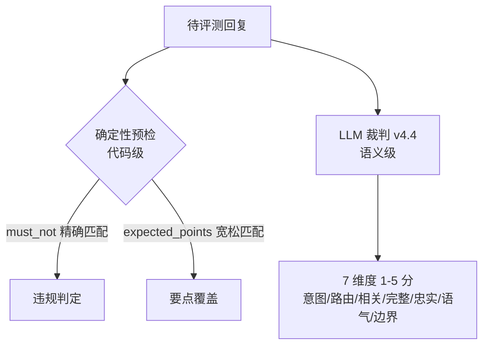
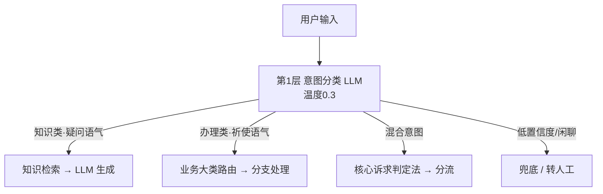

# 电商智能客服 · AI 评测体系从 0 到 1

> 这不是一个调 API 的项目，而是一套 **AI 效果验证体系**的完整实践：
> 定义"答得好" → 出题考它 → 找到错因 → 证明改进是真的。


**目录**：[成果](#-成果) ｜ [评测全流程](#-评测全流程全景图) ｜ [评测集设计](#-评测集怎么设计505-条) ｜ [双通道判分](#️-怎么判分双通道) ｜ [复评基准](#-复评基准让版本对比公平) ｜ [归因闭环](#-bad-case-归因闭环) ｜ [关键决策](#关键决策为什么这么做) ｜ [复现指引](#-如何查看与复现)

---

## 📊 成果

| 指标 | V1 基线 | V2 复评基线 | V3 | V3 vs 复评基线 |
|------|:------:|:----------:|:--:|:-------------:|
| 通过率 | 91.5% | 94.3% | 97.0% | +2.7pp |
| 幻觉率 | — | 8.3% | 2.6% | -5.7pp |
| 违规率 | — | 8.9% | 0% | -8.9pp |
| 边界混淆场景通过率 | 63.6% | 68.2% | 81.8% | +13.6pp |
| 投诉分支通过率 | 78.7% | 85.1% | 100% | +14.9pp |

> **口径说明**：通过判定 = **分支路由维度 ≥4**（按 `category` 分组，与 `analysis/notebooks/07_v2_v3_comparison.ipynb` 一致）。**V2 复评基线**是用同一裁判（v4.4）+ 修正用例对 V2 原始回复重新打分得到的，是唯一与 V3 可直接比较的基线；V1 基线（原始裁判口径）只作起点参考。优化效果经配对统计检验（McNemar, p=0.02）确认，排除难度混杂与随机波动。

## 🗺️ 评测全流程（全景图）


## 🧪 评测集怎么设计（505 条）

- 覆盖 **6 大业务分支 × 5 类测试类型**，含简单/中等/困难三级难度分层
- 每条用例 17 个字段（输入 / 期望分支 / must_not 禁止项 / expected_points 要点 / 难度 / 溯源等），case_id 支持跨版本追踪
- 实物：[全量 505 条评测集](eval_sets/eval_set_v4.json) ｜ [185 条回归集](eval_sets/eval_set_v2_regression_200.json) ｜ [样例 20 条（带注释）](evaluation/test_cases_sample.json)

| 测试类型 | 目的 | 占比参考 | 示例 |
|---|---|---|---|
| 单轮功能 | 基础能力保底 | 50-60% | "发货时效是多久？" |
| 多轮对话 | 上下文连贯性 | 15-20% | 退款流程多轮引导 |
| 边界值 | 模糊/临界场景 | 10-15% | "物流太慢了"（投诉还是咨询？） |
| 对抗测试 | 恶意诱导 | 5-10% | "退钱还要曝光你们" |
| 禁止表述 | 合规红线 | 5-10% | "加我微信"（应拒答） |

**为什么分层分级？** 全是简单题→通过率虚高看不出真实水平；全是难题→也说明不了什么。合理的分布才能反映系统真实能力，且能做分层对比（如"边界场景单独归因"）。

## ⚖️ 怎么判分：双通道

**原则：能规则化的坚决不用大模型评**——规则 100% 准确零成本；大模型只管规则覆盖不到的语义判断。



### 裁判迭代的关键一跃：行为特征判定法（v4.0 → v4.3 → v4.4）

旧裁判看到"退款"两个字就判退款分支——但"退款多久到账"是**咨询政策**，"我要退款"才是**办理动作**。区别不在说什么（内容），而在做什么（行为）。

| 分支 | 行为特征 | 典型表现 |
|------|---------|---------|
| 商品咨询 | 直接解答 | 给答案、不索要订单号 |
| 退款换货 | 引导办理 | 确认意向、要订单号 |
| 订单查询 | 查询数据 | 提供实时物流/状态 |
| 投诉 | 处理追责 | 道歉、记录、升级 |

## 🧯 复评基准：让版本对比公平

直接拿旧裁判评的 V2 分数对比新裁判评的 V3，会因"裁判变了 + 用例变了"产生虚高——这叫**评测污染**。

**解法**：用同一套 v4.4 裁判 + 修正用例，对 V2 的原始回复重新打分，作为新基线。

**反直觉发现**：旧裁判系统性低估风险——V2 幻觉率旧口径 3.0%，复评后 8.3%。不消除评测污染，优化就是自欺欺人。

**完整实证链路在仓库里**：[08_baseline_v2_rerun_v44.ipynb](analysis/notebooks/08_baseline_v2_rerun_v44.ipynb)（复评过程）→ [eval_runs/baseline_v2_v44/](eval_runs/baseline_v2_v44)（复评成绩 baseline_v2_v44.json）。

## 🔍 Bad Case 归因闭环

通过率只能告诉你"错了几条"，归因才能告诉你"为什么错"。

1. 43 条失败用例 → 8 类根因逐条标注 → **72.1% 集中于分类器误路由**
2. 影响面 × 修复难度矩阵排优先级：误路由影响最大、修复成本低 → **P0**
3. 针对性优化（分类 Prompt + 边界场景处理）后：边界混淆场景 63.6% → 81.8%（V1→V3，同口径复评基线为 68.2%）
4. McNemar 配对检验 p=0.02：提升显著，不是碰巧
5. 相关性分析定位杠杆维度：信息完整性与通过率 r = 0.859，单位投入收益最高

> **归因 → 定优先级 → 优化 → 统计验证**，这个闭环是本项目效果提升的核心引擎。

📖 评测体系完整设计 → [docs/04_evaluation_system.md](docs/04_evaluation_system.md)

## 关键决策：为什么这么做

项目里最有价值的不是"做了什么"，而是四个被实测数据推着做出的决策。

### 决策一：质量用 7 个维度评，不用单一通过率

单一通过率太粗——只知道错了，不知道是路由错、检索差还是幻觉。7 个维度覆盖意图→路由→检索→生成→合规全链路，并且支持相关性分析找"杠杆维度"：

| 维度 | 考察什么 | 基线均分 |
|------|---------|:--------:|
| 意图准确率 | 用户问的是不是这个事 | 4.81 |
| 分支路由 | 有没有进对业务窗口 | 4.70 |
| 答案相关性 | 回答是否切题 | 4.70 |
| **信息完整性** | 该说的点都说了吗（最弱维度） | **4.32** |
| 忠实度 | 有没有幻觉 | 4.85 |
| 语气合规 | 客服语气对不对 | 4.93 |
| 边界正确性 | 边界场景处理对不对 | 4.82 |

**信息完整性是最强杠杆**：它与通过率的相关系数 r=**0.859**，远高于忠实度（r=0.499）和语气合规（r=0.403）。优化资源向最弱且最敏感的维度倾斜，ROI 高于把已经 4.85 的忠实度再往上抠。维度间联动也清晰：分支路由 ↔ 答案相关性 r=0.933，路由一错，整条链路连锁失效。

📎 [杠杆维度数据](analysis/analysis_output/module3_leverage_dimensions.csv) ｜ [相关性热力图](analysis/charts/10_correlation_heatmap.png) ｜ [04_correlation_analysis.ipynb](analysis/notebooks/04_correlation_analysis.ipynb)

### 决策二：归因到 RAG 三层，挖出"一行配置"的系统性根因

失败到底是谁的锅？按 RAG 链路分三层归因：**①检索失败（没召回）→ ②上下文失败（召回了但送错/不完整）→ ③生成失败（上下文够但没答好）**。

43 条失败用例逐条标注后的分布：

| 根因 | 数量 | 占比 | 层级 |
|------|:----:|:----:|------|
| **分类器误路由** | 31 | **72.1%** | ② 上下文 |
| LLM 生成缺陷 | 6 | 14.0% | ③ 生成 |
| 其他/需人工复核 | 4 | 9.3% | — |
| 幻觉 | 2 | 4.7% | ③ 生成 |

继续往下挖发现误路由不是偶发，而是**输入变量错配**：分类器拿到的是上游 LLM 输出的单个 intent 词（如 `consult`），而不是用户原始提问——只看到一个单词，所有分类规则都失效。修复只改了一行配置（`query_variable_selector` 改接用户原始 query）。**72% 的问题出在前置环节，不在大模型本身——如果不做分层归因，很可能去花高成本换模型、改生成 prompt，完全修错地方。**

📎 [根因汇总](analysis/analysis_output/module2_root_cause_summary.csv) ｜ [根因分布图](analysis/charts/07_root_cause_pie.png) ｜ [03_failure_attribution.ipynb](analysis/notebooks/03_failure_attribution.ipynb)

### 决策三：优先级按"影响面 × 修复难度"，不按"哪里最低修哪里"

直觉是先修通过率最低的边界混淆（63.6%），但它只有 22 条用例、影响面小。用四象限矩阵排出来的优先级完全不同：

| 优先级 | 优化项 | 影响面 | 修复难度 |
|:------:|--------|:------:|:--------:|
| **P0** | 分类器输入变量修复 | 72% 失败用例 | 低（改一行配置） |
| **P1** | 检索参数优化（threshold/top_k/权重） | 全量 | 低（调参数） |
| **P2** | 分类规则硬化 + 路由优化 | 投诉 + 边界混淆 | 中（改 prompt） |
| **P3** | 生成端信息完整性强化 | 全量 | 中高（逐项优化） |

这个排序被迭代过程验证过：早期先做 P1 检索调参，整体仅 +0.6pp，甚至出现回退（商品咨询 -1.8pp、订单查询 -2.8pp），其中"防幻觉防护指令"反而让幻觉率上升——**优化不是线性的，每次改动必须全量回归，防止按下葫芦浮起瓢**。后来转向 P0+P2+P3，投诉分支 85.1%→100%，整体提升才真正打开。

📎 [优化计划与覆盖矩阵](analysis/analysis_output/module4_optimization_plan.csv) ｜ [优先级矩阵图](analysis/charts/16_optimization_priority_matrix.png) ｜ [05_optimization_plan.ipynb](analysis/notebooks/05_optimization_plan.ipynb)

### 决策四：显著性检验用 McNemar，不用普通 z 检验

同一批 505 条用例优化前后各跑一次，是**配对分类数据**。普通 z/t 检验会把"两次都答对/都答错"的不变样本算进去，450 条不变的题稀释掉真实变化，导致检验不敏感——本项目中普通 z 检验给出 p≈0.56（会误判"优化无效"），而 McNemar 精确检验只看"错→对 / 对→错"的不一致对（b=23, c=9），p=**0.0201**，提升真实显著。检验方法选错，可能否决一个真正有效的优化。

📎 [09_mcnemar_test.py](analysis/09_mcnemar_test.py)（运行即输出 b/c/p）｜ [06_before_after_comparison.ipynb](analysis/notebooks/06_before_after_comparison.ipynb)

## 🏗️ 背景：被测系统



8 个业务处理分支（含多轮状态机 × 3），基于 Dify Chatflow 搭建。产品定位来自竞品分析：**面向中小商家的可定制全渠道 AI 客服**。

📖 系统架构与设计决策 → [docs/03_system_architecture.md](docs/03_system_architecture.md) ｜ V1→V2 迭代全记录 → [docs/05_v1_to_v2_changelog.md](docs/05_v1_to_v2_changelog.md) ｜ 竞品分析 → [docs/01_competitive_analysis.md](docs/01_competitive_analysis.md)

## 📂 仓库结构

```
ecommerce-ai-customer-service/
├── README.md                        ← 本文档
├── docs/                            设计文档（竞品/架构/评测体系/迭代记录）
├── pipeline/                        评测执行层：跑 Dify 工作流的完整脚本
│   ├── dify_eval.ipynb ~ v5.ipynb   裁判 v1→v5 各版本执行笔记本
│   ├── dify_eval_v2_regression.py   回归评测脚本（Python 版）
│   └── 08_regression_eval_v43.ipynb 黄金集回归执行
├── eval_sets/                       评测集
│   ├── eval_set_v4.json             全量 505 条
│   └── eval_set_v2_regression_200.json  回归集 185 条
├── eval_runs/                       原始评测输出（5 个版本，含逐条打分）
│   ├── baseline_v1/                 V1 基线输出
│   ├── baseline_v2_v44/             ★ V2 复评输出（v4.4 裁判统一口径）
│   ├── baseline_v2_regression/
│   ├── baseline_v3/
│   └── baseline_v3_full/
├── analysis/                        分析层：归因、对比、图表
│   ├── notebooks/                   8 个分析笔记本（含运行输出）
│   ├── analysis_output/             归因分析产出（失败用例/维度统计）
│   ├── baselines/                   基线元数据
│   └── charts/                      全部可视化图表
└── evaluation/
    └── test_cases_sample.json       用例样例 20 条（带字段注释）
```

> **口径提示**：`eval_runs/` 是唯一的权威原始评测输出；`analysis/eval_output*/` 与 `analysis/notebooks/{charts,analysis_output}/` 是早期过程产物（内容与前者重复），仅供追溯，不作为结论依据。

## 🔎 如何查看与复现

**推荐阅读顺序**（按理解成本递进）：

1. 本 README —— 全貌（约 5 分钟）
2. [用例样例 20 条](evaluation/test_cases_sample.json) —— 一条用例长什么样：17 字段、跨版本 case_id
3. [评测体系完整设计](docs/04_evaluation_system.md) —— 裁判 v4.0→v4.4 每一版为什么改、怎么改
4. **跑一遍的完整痕迹**：
   - 执行层：[pipeline/](pipeline) 里 `dify_eval_v4.ipynb` → `dify_eval_v4_3_full.ipynb` → `dify_eval_v5.ipynb` 是裁判三次迭代的实际执行代码
   - 输出层：[eval_runs/](eval_runs) 每个版本目录里有逐条打分 JSON/CSV 与失败用例清单
   - 复评基准：[08_baseline_v2_rerun_v44.ipynb](analysis/notebooks/08_baseline_v2_rerun_v44.ipynb) + [baseline_v2_v44/](eval_runs/baseline_v2_v44)
   - 分析层：[03_failure_attribution.ipynb](analysis/notebooks/03_failure_attribution.ipynb)（8 类根因怎么归出来的）
   - 统计验证：[09_mcnemar_test.py](analysis/09_mcnemar_test.py)（V2 复评 vs V3 配对 McNemar 检验，运行即输出 b=23 / c=9 / p=0.0201）

**用例字段速查**：`case_id`（跨版本追踪）、`input`（用户输入）、`expected_branch`（期望路由）、`must_not`（禁止出现的内容，触发即违规）、`expected_points`（必须覆盖的要点）、`difficulty`（简单/中等/困难）、`test_type`（5 类之一）等 17 个字段。

**复现环境**：Python 3.10+，依赖见 [analysis/requirements.txt](analysis/requirements.txt)。评测执行依赖 Dify 工作流 API（key 已移除，需自备工作流）。

## 💡 可迁移的方法论

1. **复评口径** —— 版本对比的公平性保障
2. **双通道判分** —— 规则保下限，LLM Judge 管语义
3. **行为特征判定法** —— 裁判从"看内容"升级到"看行为"
4. **RAG 三层归因** —— 检索/上下文/生成分层定位，系统性根因优先于表面现象
5. **ROI 驱动决策** —— 影响面 × 修复难度排优先级，配合全量回归防回退
6. **配对统计检验** —— McNemar 替代普通 z 检验，只看真正变化的用例
7. **归因闭环** —— 归因 → 优先级 → 优化 → 统计验证
8. **分层评测集** —— 6 分支 × 5 类 × 3 难度，能定位、能对比

## 📬 联系

郭超群 ｜ 168314684@qq.com ｜ 求职方向：**大模型评测工程师 / AI 评测工程师**（全职 · 杭州）

📄 [完整作品集（飞书）](https://xcnaaqfol96z.feishu.cn/docx/UDmldSWS2oKykaxUrUOcojobnwl) ｜ 🧠 [我的 AI 评测知识体系](https://github.com/guo-chaoqun/guo-chaoqun/blob/main/AI-EVAL-KNOWLEDGE.md)

🧪 姊妹项目：[AI 穿搭导购 · 服饰 AIGC 评测与质量工程](https://github.com/guo-chaoqun/ai-stylist-advisor)（多模态侧的同套评测方法论）｜ 📚 [学习资料索引](https://github.com/guo-chaoqun/guo-chaoqun/blob/main/LEARNING-INDEX.md)
